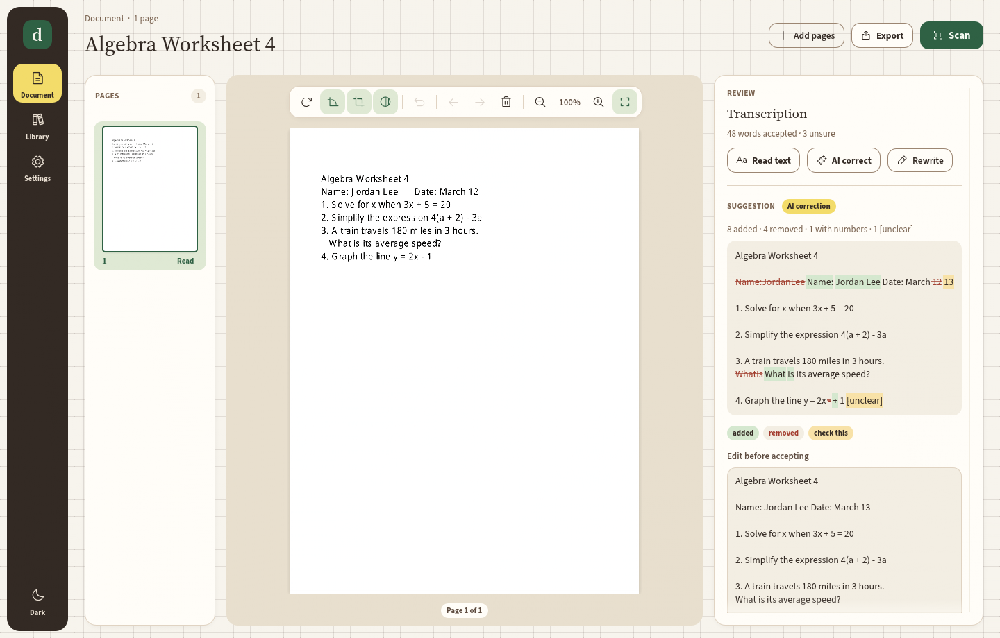

# documentaSHion

A Linux-first Rust/egui scanning workspace for the Fujitsu ScanSnap iX500, school materials, exams, and handwritten notes. It shares verSHion's design system: the dark dock with a highlighter-yellow active item, cream graph-paper desk, rounded cards, Source Sans / Source Serif, Phosphor icons, verSHion's button tiers, and its warm dark mode (`src/ui/`).



## Run

Launch **documentaSHion** from the desktop application menu after installation, or run `documentashion`. The dock on the left has three screens: **Document**, **Library** and **Settings**, plus a light/dark switch.

1. Connect and power on the iX500 over USB.
2. In **Settings → Scanner**, press **Find scanners** and choose the device, whether to scan both sides, and the resolution. Settings save as you change them.
3. Load paper and press **Scan** (top right of the Document screen). Completed batches become pages in the current project. **Add pages** imports images or a PDF.
4. New pages are cleaned up automatically: tilted pages are straightened, dark scanner edges are trimmed, contrast is raised, and near-empty pages (such as the backs of single-sided sheets) are marked **Blank?**. The page sits on a tray in the middle with a floating tool bar: rotate, straighten, crop, contrast, undo, move earlier/later, remove, and zoom. Each cleanup step is a per-page toggle you can switch off or undo; **Remove blank** in the page list takes blank pages out in one step, and **Restore removed** brings them back.
5. In the **Review** panel on the right, use **Read text** (Tesseract, on this computer), **AI correct** or **Rewrite**. Suggestions show word-level changes: added words are green, removed words are struck out, and changed numbers, `[unclear]` markers and words Tesseract was unsure of are amber. Edit if needed, then **Accept** or **Reject**. Rewriting is kept in a separate field and never replaces the scan.
6. **Export** gives a searchable PDF, page images, or text files. Projects save automatically; **Library** shows every project as a card and searches titles, accepted transcriptions, and rewrites.

Original images are copied into each project and remain unchanged. Rotation, straightening, cropping, cleanup and text corrections have per-page undo. Removed pages can be restored during the current session; original image files are retained. Manual edits also create undo entries. PDF exports include the image and accepted transcription; rewritten versions export separately as text.

## AI

Settings supports local Ollama, Ollama Cloud, OpenRouter, and custom OpenAI-compatible endpoints, including local servers. Enter a model that accepts images. A model is not downloaded or selected automatically.

- Ollama: `http://127.0.0.1:11434`
- Ollama Cloud: `https://ollama.com/v1`
- OpenRouter: `https://openrouter.ai/api/v1`
- Custom compatible services: provide their API base, usually ending in `/v1`.

A key typed in Settings is used for the session. **Save to keychain** stores it in the desktop keychain (Secret Service: KWallet or GNOME Keyring) under the service `documentaSHion`, one entry per provider (and per endpoint for Custom). It is loaded at start-up and never written to `settings.json`. **Forget saved key** deletes it. If no keychain is running, the key stays in memory for the session only. Environment variables still work: `OLLAMA_API_KEY`, `OPENROUTER_API_KEY`, or `DOCUMENTASHION_AI_KEY`. No credentials are imported from verSHion. Cloud AI receives the selected page image and its current transcription when an AI action is clicked. Local OCR does not make a network request.

AI prompts preserve question numbering, facts, equations and answer blanks, avoid answering exam questions, and request `[unclear]` for illegible writing. Model results still require review. Accept and Reject control changes; originals are never modified by AI.

## Dependencies and build

Rust 2024, egui/eframe 0.36 with wgpu. Scanning uses the installed SANE `scanimage` executable; only the Fujitsu backend is loaded through an app-specific SANE configuration. This avoids crashes caused by unrelated system backends during device discovery. System SANE configuration is not changed.

Runtime programs:

- `scanimage`, Fujitsu SANE backend: scanning.
- `tesseract` 4 or 5 and English trained data: optional local OCR. Settings shows whether it was found. Set `DOCUMENTASHION_TESSERACT` to use a binary outside `PATH`.
- `pdftoppm` (Poppler): optional PDF import.

On Fedora, optional OCR packages are typically `tesseract` and `tesseract-langpack-eng`; install them through your package manager. They were not installed automatically.

```sh
cargo build --release --locked
cargo test --locked
./install.sh target/release/documentashion
```

Use `cargo ... --offline` when all locked dependencies are cached. The installer also accepts an absolute binary path.

## Storage

`${XDG_DATA_HOME:-~/.local/share}/documentashion/` contains:

- `settings.json`: non-secret preferences.
- `projects/<id>/project.json`: project title, page order, accepted text, rewrites, and undo history.
- `projects/<id>/`: preserved images and scanner captures.
- `imports/`: rasterized PDF imports.
- `sane/`: isolated Fujitsu backend configuration.

Back up the entire directory. Search operates over local JSON projects; no cloud library or indexing service is involved. PDF import rasterizes pages at 300 DPI and does not preserve the original PDF's text or vector objects.

## Alpha limits and verification

- Cleanup straightens skew up to 15° by finding the angle at which text rows line up most sharply; pages without a clear text direction (photos, drawings) are left as they are. Border trimming only removes dark scanner background, not white margins. Automatic 90°/180° orientation detection is not implemented; use Rotate.
- Local OCR keeps Tesseract's word boxes and confidences. In exported PDFs each word of the accepted text is placed on its word in the scan, including words corrected afterwards (a corrected word takes the box of the word it replaced). If a page is rotated, straightened or cropped after OCR, the boxes no longer fit; the PDF falls back to approximate lines until Local OCR is run again. AI transcriptions have no boxes of their own and reuse the OCR boxes when the page was OCR'd first. PDF/A is not implemented.
- The highlights compare words, not characters: a one-letter fix shows as the whole word removed and added. Source-region highlighting on the scan is not implemented.
- Project names, scans, transcriptions and rewrites are local and unencrypted. Search matches literal substrings; handwriting becomes searchable after transcription.
- Scans and OCR run in external processes with cancellation and a five-minute timeout. AI has a three-minute request timeout; Cancel discards its result but does not abort an already sent HTTP request. Pages are added after a batch finishes, not streamed live.
- Interrupted scanner captures remain in the project's capture folder and can be recovered with Import images. Only complete decodable files are imported.
- Original images and cancelled PDF imports remain on disk. There is no automatic trash cleanup.
- Physical iX500 scanning and live AI calls were not verified during development. Fujitsu-only discovery exited successfully but detected no connected scanner in the execution environment. The native display could not be opened in the sandbox; layout was checked by rendering the actual egui interface headlessly.

Tests cover undo (including projects saved by the first alpha), project serialization, skew detection in both directions, border trimming, blank detection, the word diff and box placement, review highlighting, Tesseract TSV parsing, keychain error handling, and PDF extraction using Poppler (Unicode text and word positions). Two tests need outside resources and are ignored by default:

```sh
cargo test tilted_worksheet -- --ignored   # needs pdftoppm, pdftotext, tesseract + eng
cargo test live_keychain -- --ignored      # writes and deletes a test entry in your keychain
``` Headless visual QA:

```sh
XDG_DATA_HOME=/tmp/documentashion-preview ./target/release/documentashion --preview /tmp/workspace.png
```

`DOCUMENTASHION_PREVIEW_PROJECT` optionally points to a project JSON. `DOCUMENTASHION_PREVIEW_SCREEN=library|settings` picks the screen, `DOCUMENTASHION_PREVIEW_SECTION=<n>` the settings section, `DOCUMENTASHION_PREVIEW_DARK=1` the dark theme, `DOCUMENTASHION_PREVIEW_CROP=1` opens the crop card, and `DOCUMENTASHION_PREVIEW_PROPOSAL=<file>` shows that text as a suggestion. Preview renders the actual egui meshes with a CPU renderer; no display server is needed.

## Source layout

- `src/main.rs`: start-up.
- `src/app.rs`: application state, background work, the dock and the status toast; `src/app/document.rs`, `library.rs` and `settings.rs` are the three screens.
- `src/ui/theme.rs`, `src/ui/kit.rs`: verSHion's palette, fonts, icons and controls.
- `src/model.rs`: projects, originals, page transformations, undo and persistence.
- `src/imaging.rs`: skew detection, straightening, border trimming and blank-page detection.
- `src/diff.rs`: word diff, and placement of accepted text onto OCR word boxes.
- `src/review.rs`: word-level highlighting for suggestions and unsure OCR words.
- `src/secrets.rs`: API keys in the system keychain.
- `src/services.rs`: isolated scanner/OCR/PDF-import processes and AI provider transport.
- `src/pdf.rs`: image PDF export with an embedded Unicode text layer.
- `src/preview.rs`: headless egui rendering for layout checks.

Font licenses are included under `assets/`. The theme and controls follow verSHion (MIT, same author).
